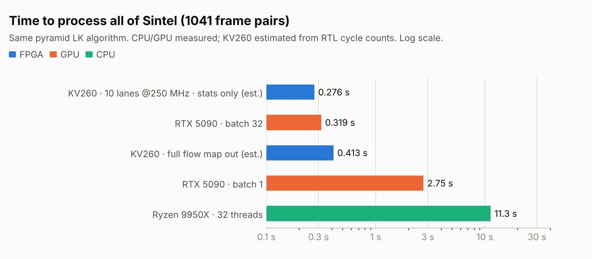
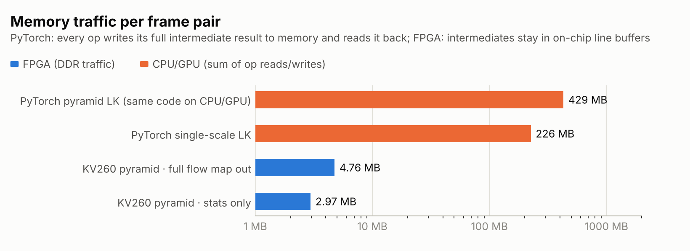
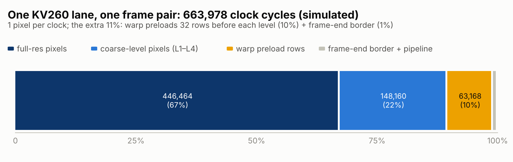
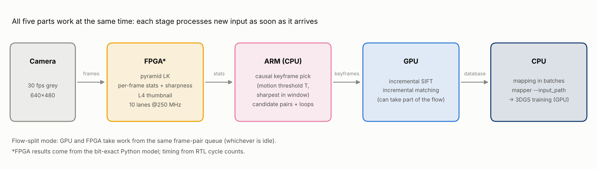
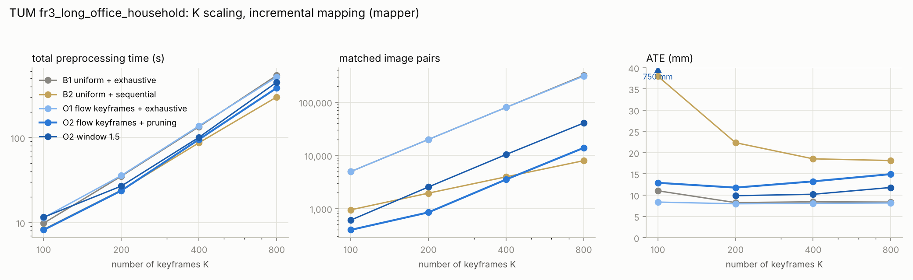
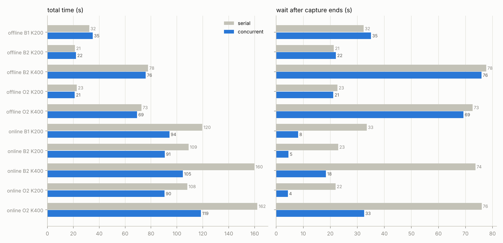

# optical-flow-fpga

Pyramid Lucas-Kanade optical flow [1, 2] in Verilog, plus a heterogeneous (FPGA + GPU + CPU) preprocessing pipeline that uses on-chip flow statistics to pick keyframes and prune image pairs before COLMAP / 3D Gaussian Splatting.

> **Status: simulation only.** The design has not been run on an FPGA board yet. Every hardware result below comes from RTL simulation (Icarus Verilog) checked bit-exact against a Python fixed-point model. Hardware times are cycle counts divided by an assumed clock; resource numbers come from Yosys, not Vivado; clock frequency is a rough estimate (about ±30%). The target board is an AMD Kria KV260 (K26, Zynq UltraScale+).

## What is here

```
rtl/             pyramid LK RTL (current version)
  lk_pyramid.v     top level: pyramid build, per-level warp + LK, on-chip statistics (motion, histogram, sharpness lk_sharp)
  lk_level.v       one pyramid level: upsample coarse flow, warp, LK, merge, residual clamp, statistics
  lk_warp.v        bilinear warp (4 banks, 64-line ring buffer, vertical search +-30 px)
  lk_top.v         single-level three-stage pipeline: gradient -> 5x5 window sums -> 2x2 solve
  lk_gradient.v / lk_window.v / lk_solve.v / lk_multi.v (multiple lanes)
rtl_v1/          first single-scale version (kept for comparison)
tb/              self-checking testbenches (compare every pixel with the Python reference, print PASS/FAIL)
python/          fixed-point reference models, test-vector generation, cycle model, speed/accuracy evaluation
  lk_golden.py     single-level LK reference + test vectors
  lk_pyramid.py    bit-exact pyramid LK model (including frame sharpness)
  rtl_cycle_model.py, timing_est.py, synth_report.py, fpga_*.py, bench_*.py, pyr_eval.py, prof_speed.py, sintel_tools.py ...
run_sim.py       one-command simulation (Windows / macOS / Linux)
preprocessing/   heterogeneous 3DGS preprocessing
  hetero_prep.py   batch pipeline: flow / run / select / report
  stream_prep.py   streaming pipeline: FPGA, GPU and CPU threads work at the same time; --serial for comparison; flow can be split between FPGA and GPU
  gpu_flow.py      float32 PyTorch version of the same algorithm (GPU flow)
  run_stream_exp.py, analyze_*.py, colmap_io.py, run_3dgs.py, eval_render.py, synth_tum.py, *.ps1
docs/figures/    figures used in this README
```

## Hardware design

- One pixel per clock in steady state. Gradient (central differences) -> 5x5 window sums -> closed-form 2x2 solve in Q8 fixed point; pixels with a small determinant are flagged as unreliable.
- Pyramid: 5 levels built by 2x2 averaging while the full-resolution frame streams in. Each level upsamples the coarser flow x2 as a guess, warps the second image bilinearly, runs LK on the residual and clamps the per-level update to +-1 px.
- At full resolution the design can output only a few statistic registers per frame (count, sum of u and v, mean |u|+|v|, max, 8-bin histogram, sharpness) instead of a dense flow map. This is what the preprocessing pipeline uses to choose keyframes, and it keeps DDR traffic very small.
- The pipeline is cut into short stages (6 in the window stage, extra registers in the solver, registered ready signals) to aim for 250 MHz.

## RTL simulation

Needs Python 3 + numpy and Icarus Verilog (Windows: https://bleyer.org/icarus/ ; macOS: `brew install icarus-verilog`; Linux: `apt install iverilog`). Use a path without non-ASCII characters.

```bash
python run_sim.py          # everything: single level 5 cases x 2 testbenches + multi-lane 2 cases + pyramid 6 cases
python run_sim.py pyr      # pyramid cases only
```

Each case should end with `*** PASS ***`. Waveforms: `gtkwave wave_top_smooth.vcd`.

All 18 cases pass. In the pyramid testbenches the testbench acts as DMA: the hardware's own output for one level is fed back as the input of the next, and five things are compared bit by bit (pyramid, warp, per-level update, final u/v/flag, statistic registers). Four real Sintel frame pairs at 1024x436 were also simulated through all 5 levels and matched the model exactly.

## Results on MPI Sintel (clean, all 1041 training pairs)

Dataset: [MPI Sintel](http://sintel.is.tue.mpg.de/) [3], downloaded from the official site; no Sintel data is included in this repository.

Accuracy of the fixed-point model (= RTL output), end-point error in pixels. Zero-flow baseline: 13.48.

| configuration | EPE all | motion <1 px | 1-5 | 5-20 | >20 | statistic vs ground truth (Spearman) |
|---|---|---|---|---|---|---|
| single scale | 13.53 | 0.74 | 2.93 | 10.15 | 41.40 | 0.877 |
| 5 levels, +-1 px clamp (default) | 11.26 | 3.00 | 3.65 | 6.20 | 35.73 | 0.974 |
| 6 levels, +-1 px clamp | 11.14 | 4.18 | 4.74 | 7.40 | 33.53 | 0.967 |

Single-scale LK is no better than outputting zero on Sintel, which is why the pyramid was added. The pyramid helps large motion but makes very small motion worse (0.74 -> 3.00 px); that is an open problem. The per-frame statistic tracks true motion well (rank correlation 0.974). Picking keyframes with it finds 89% of the ground-truth keyframes within +-1 frame.

Time to process all 1041 pairs with the same pyramid algorithm:

| platform | time | source |
|---|---|---|
| KV260, 10 lanes @250 MHz, statistics only | 0.276 s | estimated from RTL cycles |
| KV260, dense flow output | 0.413 s | estimated (limited by DDR bandwidth) |
| RTX 5090, batch 32 | 0.319 s | measured (about 385 W) |
| RTX 5090, batch 1 | 2.75 s | measured |
| Ryzen 9 9950X, 32 threads | 11.33 s | measured |



Why the gap: the PyTorch version issues about 350 small GPU kernels per pair, so at batch 1 the GPU is idle 83% of the time, and every op writes its full intermediate image back to memory (429 MB of traffic per pair). On the FPGA intermediate results stay in on-chip line buffers, so only 2.97 MB per pair touches DDR (`python/prof_speed.py`).




Resources (Yosys `synth_xilinx -family xcup`, one pyramid lane): 7,175 LUT, 8,053 FF, 40 DSP, 10 BRAM36, 4 URAM. LUTs limit the K26 to about 10 lanes. Rough Fmax estimate from `python/timing_est.py`: 256 MHz. Both numbers need to be confirmed with Vivado on a real board.

## Preprocessing pipeline for 3DGS

The architecture below shows the full heterogeneous pipeline from raw video to 3D Gaussian Splatting, with the FPGA handling optical flow on chip and the GPU / CPU sharing the rest of the work.



### Step-by-step

**① Camera → Frames.** A video stream (30 fps, 640×480) is decoded into individual grayscale frames on the CPU. Each frame is numbered sequentially. Neighboring frame pairs *(t, t+1)* are dispatched to the flow engine.

**② FPGA — Pyramid Lucas-Kanade + On-Chip Statistics.** For each pair, the FPGA computes a 5-level image pyramid (coarse → fine). At every level it upsamples the coarser flow as a guess, warps the second image bilinearly, then runs a 5×5 Lucas-Kanade solve in Q8 fixed point. The per-level update is clamped to ±1 px so that no single level introduces a large error.

Instead of writing the full dense flow map to DDR, the FPGA accumulates **statistic registers on chip**:

- valid pixel count & mean motion (⟨u⟩, ⟨v⟩)
- motion histogram (8 bins) & max displacement
- frame sharpness (sum of squared horizontal and vertical pixel differences of the full-resolution frame, computed while the pyramid is built)

So the only results that leave the chip are a few 32-bit registers per frame. Counting everything (reading the frames, writing and reading the coarse levels), the FPGA moves **2.97 MB through DDR per pair**, compared with 429 MB of memory traffic in the PyTorch version.

**③ CPU — Keyframe Selection & Candidate-Pair Pruning.** The statistics stream is consumed by an ARM CPU core on the KV260 (in the experiments here, this step ran on the PC CPU). Keyframes are chosen by *accumulated optical flow*: when the integrated motion since the last keyframe exceeds a threshold, the sharpest frame in that window is selected as the next keyframe. Fast-moving segments get more keyframes; still segments get fewer.

Candidate image pairs for COLMAP are then pruned in two stages:

- *Sequential pairs*: frames within a motion-adaptive window around each keyframe (based on the FPGA statistics, not brute-force).
- *Loop closure*: a thumbnail ZNCC check between non-adjacent keyframes (using the coarsest pyramid level already computed on the FPGA).

This cuts the number of image pairs from K(K−1)/2 to a number that grows much more slowly: 19,900 → 846 at K=200 and 319,600 → 13,851 at K=800.

**④ GPU — COLMAP SIFT + Matching.** The selected keyframes and candidate pairs are sent to COLMAP running on the GPU. SIFT features are extracted incrementally (only new keyframes are processed), and matches are computed for the pruned pair list.

**⑤ CPU — Incremental Mapping.** COLMAP builds a sparse 3D reconstruction: camera poses and a point cloud, grown incrementally as new keyframes arrive.

**⑥ 3D Gaussian Splatting.** The keyframes and camera poses are fed into a 3DGS trainer, which produces the final photorealistic rendering.

### Streaming vs. Batch

In **batch mode**, each stage finishes completely before the next begins. In **streaming mode** (the diagram above), the pipeline operates like an assembly line:

| Thread | Runs on | What it does |
|--------|---------|--------------|
| camera | CPU | Hands out frames at 30 fps, dispatches pairs |
| fpga | FPGA | Pyramid LK + statistics (~1.8 ms per pair per lane at 250 MHz) |
| gpu_flow | GPU | Optional: parallel GPU flow engine, shares the task queue |
| select | CPU (ARM) | Causal keyframe selection once statistics arrive |
| colmap_gpu | GPU | Incremental SIFT extraction + matching |
| mapper | CPU | Continues mapping from the previous sparse model |

All six threads run concurrently, with thread-safe queues passing data between stages. In online capture mode (frames arriving at 30 fps), streaming reduces the end-of-capture wait from **21.9 s → 4.3 s** for O2 at K≈189.

### Running

Requirements: numpy, [COLMAP](https://colmap.github.io) [5] (tested with 4.2.1), optionally PyTorch (GPU flow) and [graphdeco-inria/gaussian-splatting](https://github.com/graphdeco-inria/gaussian-splatting) [6] (not included). Dataset: [TUM RGB-D](https://cvg.cit.tum.de/data/datasets/rgbd-dataset) [4] `fr3_long_office_household` (not included).

```bat
:: 1. FPGA flow statistics (results from the Python fixed-point model, time from the RTL cycle formula)
python preprocessing\hetero_prep.py flow --seq <TUM sequence dir> --work <work> --jobs 16
:: 2. compare four methods
python preprocessing\hetero_prep.py run --work <work> --K 200 --colmap <colmap.exe> --methods B1 B2 O1 O2
python preprocessing\hetero_prep.py report --work <work>
:: 3. streaming (everything at once) experiments
python preprocessing\run_stream_exp.py --work <work> --out <out> --colmap <colmap.exe>
```

Methods: B1 uniform frames + exhaustive matching; B2 uniform frames + sequential matching; O1 flow keyframes + exhaustive; O2 flow keyframes + flow-pruned candidate pairs + thumbnail ZNCC loop closure (the proposed method).

---

### Results

On an RTX 5090 PC (FPGA part from the bit-exact model, 10 lanes @250 MHz, 452,755 cycles per 640x480 pair):

Batch, incremental mapping:

| K | method | total time | ATE |
|---|---|---|---|
| 200 | B1 | 35.1 s | 8.2 mm |
| 200 | B2 | 24.0 s | 22.3 mm |
| 200 | O2 | 23.7 s | 11.8 mm |
| 800 | B1 | ~540 s | 8.4 mm |
| 800 | O2 | ~384 s | 14.9 mm |

Global mapping (COLMAP `global_mapper`, i.e. GLOMAP [8]), K=800: O2 203 s vs B1 463 s. 3DGS [6] test PSNR at K=200: B1 26.52 / O1 26.22 / O2 26.02 / B2 25.72 dB. So O2 is faster than exhaustive matching but somewhat less accurate; it is a speed/quality trade-off, not a free win.



Splitting flow between FPGA and GPU (2584 pairs): FPGA 495 ms, GPU 979 ms, static split 333 ms, dynamic split 331 ms. The end-to-end gain is negligible because flow is a tiny part of the total.

Streaming vs serial, online capture at 30 fps (how long you wait after capture ends):

| setup | streaming | serial |
|---|---|---|
| O2, K~189 | 4.3 s | 21.9 s |
| B1 | 8.1 s | 33.5 s |
| O2, K~355 | 32.5 s | 76.0 s |

In offline mode (all frames available at once) streaming gives almost no benefit.



## Limitations and next steps

- Not tested on hardware. Next: Vivado synthesis and timing, then measure on a KV260.
- The pyramid hurts sub-pixel motion; a median filter on the coarse flow is the next thing to try.
- The 4096-entry guess FIFO could be replaced by recomputation from a small ring buffer, which may fit 12 lanes instead of 10.

## Data and third-party software

No dataset files, model weights or third-party source code are included in this repository; scripts expect you to download them yourself and follow their terms.

| used for | what | license / terms |
|---|---|---|
| flow accuracy and speed | MPI Sintel [3] (clean pass + ground-truth flow) | free for research; see the [Sintel site](http://sintel.is.tue.mpg.de/). The images come from the open movie *Sintel*, (c) Blender Foundation, CC BY 3.0 |
| preprocessing experiments | TUM RGB-D [4], `fr3_long_office_household` | CC BY 4.0, see the [dataset page](https://cvg.cit.tum.de/data/datasets/rgbd-dataset) |
| SfM / mapping | COLMAP [5] (SIFT [9] features and matching, incremental mapper, `global_mapper` = GLOMAP [8]) | BSD |
| novel-view evaluation | 3D Gaussian Splatting [6] (graphdeco-inria/gaussian-splatting) | Inria / MPII non-commercial research license |
| image quality metrics | SSIM [10], LPIPS [7] (`lpips` package) | see each package |
| simulation and synthesis | Icarus Verilog, Yosys (`synth_xilinx`) | GPL / ISC |
| CPU/GPU baselines | PyTorch, NumPy, Matplotlib, Pillow | see each package |

## References

1. B. D. Lucas and T. Kanade. An iterative image registration technique with an application to stereo vision. *IJCAI*, 1981.
2. J.-Y. Bouguet. Pyramidal implementation of the Lucas Kanade feature tracker. Intel Corporation, Microprocessor Research Labs, 2000.
3. D. J. Butler, J. Wulff, G. B. Stanley and M. J. Black. A naturalistic open source movie for optical flow evaluation. *ECCV*, 2012.
4. J. Sturm, N. Engelhard, F. Endres, W. Burgard and D. Cremers. A benchmark for the evaluation of RGB-D SLAM systems. *IROS*, 2012.
5. J. L. Schönberger and J.-M. Frahm. Structure-from-motion revisited. *CVPR*, 2016.
6. B. Kerbl, G. Kopanas, T. Leimkühler and G. Drettakis. 3D Gaussian splatting for real-time radiance field rendering. *ACM Transactions on Graphics* 42(4), 2023.
7. R. Zhang, P. Isola, A. A. Efros, E. Shechtman and O. Wang. The unreasonable effectiveness of deep features as a perceptual metric. *CVPR*, 2018.
8. L. Pan, D. Baráth, M. Pollefeys and J. L. Schönberger. Global structure-from-motion revisited. *ECCV*, 2024.
9. D. G. Lowe. Distinctive image features from scale-invariant keypoints. *International Journal of Computer Vision* 60(2), 2004.
10. Z. Wang, A. C. Bovik, H. R. Sheikh and E. P. Simoncelli. Image quality assessment: from error visibility to structural similarity. *IEEE Transactions on Image Processing* 13(4), 2004.

## License

MIT, see [LICENSE](LICENSE). Datasets (Sintel, TUM RGB-D) and third-party code (COLMAP, 3DGS) retain their own licenses.
